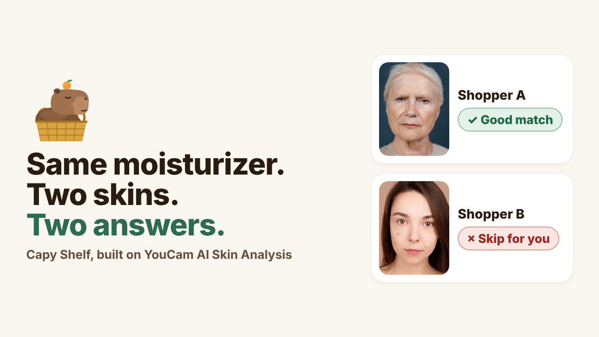

# Capy Shelf

**Is this right for *your* skin? A calm shopping buddy for the skincare aisle, built on the YouCam AI Skin Analysis API.**



- Demo video (2:24, narrated): [`demo/video.mp4`](demo/video.mp4)
- Screenshots: [`docs/screenshots/`](docs/screenshots)
- YouCam API Skin AI & eCommerce VTO Hackathon, topic: **Skin AI**

## The 30-second version

People wonder about their skin right before a purchase: standing in an aisle with a product in hand, unable to read a
40-item INCI list, after a cream once broke them out or dried them out. Capy Shelf is for that moment.

1. **Scan once.** A selfie goes to **YouCam AI Skin Analysis**. Capy keeps the concerns that decide purchases:
   breakouts, pores, oiliness, hydration, redness, texture and skin type, each with a score and a detection mask.
2. **Snap the label.** A vision model reads the ingredient list off the photo, in order, into text.
3. **Get a verdict.** A deterministic ingredient table (with cited sources) meets **this person's measured scores**:
   **Good match**, **Use with care** or **Skip for you**, which ingredients drove it, and where on the face the
   concern was seen (from the YouCam mask). The language model only words the explanation; it never decides.
4. **Compare.** Two or three products side by side, then a tiny cleanse, treat, moisturize routine from the ones that
   fit, with "what to look for instead" where nothing does.

**The aha:** the same moisturizer gets **Good match** for Shopper A and **Skip for you** for Shopper B, and Capy shows
exactly why, using each person's own skin scores. Same label, same rules; only the measured skin differs.

| | Shopper A (hydration is the main focus) | Shopper B (pores and breakouts) |
| --- | --- | --- |
| Dew Drink Gel Cream (moisturizer) | Good match: glycerin, dimethicone, niacinamide help skin hold water | Skip for you: isopropyl myristate (number 3) and myristyl myristate may clog pores; breakouts seen mostly on the cheeks |
| Clear Morning Foaming Wash (cleanser) | Skip for you: sodium lauryl sulfate can strip water, and hydration is the main focus | Good match: salicylic acid can help keep pores clear |
| Calm Dew Niacinamide Serum (treatment) | Use with care: alcohol denat. (number 6) may dry skin out; patch test first | Good match: nothing works against the scan (and Capy says it will not do much for pores either) |

**Who it is for:** anyone who has bought a product that broke them out or dried them out; people with sensitive or
breakout-prone skin; shoppers who cannot read INCI lists. The tone is Capy's: calm, plain words, no shaming, no "flaws".

## Run it

Requirements: Node 20 or newer and pnpm.

```bash
pnpm install
```

```bash
pnpm build
```

```bash
pnpm start
```

Open http://localhost:3000 and click **Start the replay**. That is the **Replay of a recorded run** mode: every YouCam
and LLM result the demo uses was recorded once from the real APIs and lives in the repo (`src/fixtures/`,
`public/fixtures/`), so a judge without keys can click through everything. A banner on every step says so.

**Live mode** (your own selfie and label photos): copy `.env.example` to `.env.local`, fill in `YOUCAM_API_KEY` and the
OpenAI-compatible LLM variables, restart, and click **Try it live**. The selfie can come from the **YouCam JS Camera
Kit** (guided capture that checks face position, pose and lighting, then shoots automatically) or from a photo upload. Keys stay on the server (Next.js route handlers);
nothing secret reaches the browser. Each live skin scan spends 12 YouCam units, so a server allows `LIVE_SCAN_LIMIT`
scans (default 5). For development: `pnpm dev`.

## How the YouCam API is used

All calls are server-side in [`src/lib/youcam.ts`](src/lib/youcam.ts), base URL `https://yce-api-01.makeupar.com`.

| Step | Call | What Capy does with it |
| --- | --- | --- |
| 1 | `POST /s2s/v2.0/file` | Registers the selfie upload and gets a pre-signed URL (free). |
| 2 | `PUT <pre-signed url>` | Uploads the image bytes with the returned headers. |
| 3 | `POST /s2s/v2.0/task/skin-analysis` | One task with `dst_actions` `acne, pore, oiliness, moisture, redness, texture, skin_type` and `format: json`. **12 units.** |
| 4 | `GET /s2s/v2.0/task/skin-analysis/{task_id}` | Polls (free) until `success`; reads `raw_score`, `ui_score`, `mask_urls`, and the `skin_type` items for whole face, T-zone and U-zone. |
| (log) | `GET /s2s/v1.0/client/credit` | Unit balance, read before and after every recorded capture. |
| (client) | YouCam JS Camera Kit v2.5, `skincare` mode | Live selfies: guided, auto-captured photos that already meet the skin analysis photo rules, so fewer scans fail. No units. |

What Capy builds on top of the raw output:

- **Bands from raw scores** (higher is healthier): 70 and up looks balanced, 50 to 69 worth watching, under 50 main focus.
  Capy decides on `raw_score` and shows both numbers; `ui_score` is YouCam's friendlier calibrated version.
- **Where on the face, from mask pixels** ([`src/lib/regions.ts`](src/lib/regions.ts)). Masks are full-size RGBA PNGs
  aligned to the photo. The moisture map covers the whole face, so its bounding box is the face box; every other mask's
  alpha is split into forehead, nose, cheeks and chin. That is how the verdict can say "breakouts seen mostly on your
  cheeks" next to an ingredient that may clog pores.
- **Skin type** (`Oily`, `Dry`, `Normal`, combinations and `Redness` variants) can raise a matching concern by one band,
  never lower it. Capy also explains the common surprise of oily skin with low hydration.
- **The detection mask overlay** is shown on the photo with toggles for each concern and the skin type zones.
- **Guided capture with the YouCam JS Camera Kit** ([`src/lib/camera-kit.ts`](src/lib/camera-kit.ts)): live quality
  hints (lighting, look straight, face position) in plain words, automatic capture, then the same analysis call.
- **Plain error messages** for the documented photo errors (`error_src_face_too_small`, `error_lighting_dark`, and so on),
  and a failed task gives the live scan back because YouCam only charges on success.

**Why SD and not HD.** SD covers every concern that decides a purchase (acne, pore, oiliness, moisture, redness,
texture, skin type), accepts any phone or laptop selfie from 480 pixels on the short side (HD needs 1080), and costs
12 units for 5 to 8 concerns instead of 16. In an aisle, speed and "works with the camera you have" matter more than
pore-level detail. HD's regional pore scores are the natural upgrade.

**Units used by this build: 48** of the shared 1,000 (two recorded demo scans, one end-to-end test of the live upload
route, and one end-to-end test of a Camera Kit capture, 12 units each). Every capture script refuses to run twice unless forced, and nothing calls YouCam in a loop.

## How the verdict is decided

Deterministic and inspectable ([`src/lib/verdict.ts`](src/lib/verdict.ts), [`src/data/ingredients.ts`](src/data/ingredients.ts)):

- Each label ingredient is matched (ignoring case and punctuation) to an effect tag such as *harsh foaming agent*,
  *drying alcohol*, *fragrance*, *listed fragrance allergen*, *essential oil*, *may clog pores*, *water magnet*,
  *barrier support*, *pore-clearing acid (BHA)*, *niacinamide*, *fatty alcohol (not drying)*.
- A risk only counts for a concern that is not balanced for this person, which is why the same label gives different
  answers. Risk weight = strength (1 or 2) x band (1 or 1.5) x position on the list (first five 1, six to ten 0.45,
  later 0.2). Rinse-off cleansers halve pore-clogging and acid risks; fragrance and essential oils use at least 0.6
  because a little can be enough to react.
- Any risk of 1.8 or more: **Skip for you**. Any of 0.6 or more: **Use with care**. Otherwise: **Good match**.
- Ingredients the table does not know are listed as "not judged", never guessed.
- The explanation model gets only a list of facts and strict rules (no new claims, no guessing from the product name).
  An early recording that over-claimed was caught and fixed; see [`docs/api-log.md`](docs/api-log.md).

Every effect tag has 1 to 3 verified sources (AAD, FDA and eCFR monographs, EU cosmetics regulations, PubMed
records) in [`src/data/sources.ts`](src/data/sources.ts), shown on the in-app **How it works** page. Where evidence
was thin, the wording says "may" or the claim was dropped (for example, centella is listed but not counted).

## Accessibility (WCAG 2.2 AA)

Built to meet WCAG 2.2 AA: semantic landmarks and headings, a skip link, visible focus rings, every control a real
button or link with `aria-pressed` or `aria-checked` state, text alternatives for photos and masks, live regions for
upload progress, touch targets above the 24 px minimum (most are 36 px or larger), color never the only signal (verdicts carry a symbol and a word),
`prefers-reduced-motion` respected, and AA contrast for all text. Checked with axe-core (WCAG 2.0, 2.1 and 2.2 A and AA
rules) on every page and every profile and product combination, at 1440 px and 390 px wide: **0 violations**.

## Honest limits

- Not medical advice and not a diagnosis. Ingredient effects are tendencies, not guarantees.
- Labels order ingredients by amount only down to about 1 percent and never give percentages.
- Comedogenicity ratings come from older rabbit-ear tests; real-world results depend on the full formula.
- One photo depends on light, camera and makeup. Rescan in similar light before comparing.
- Capy suggests a patch test for anything new, and a dermatologist for breakouts that are painful, scarring or do not settle.

## Project map

```
src/app/               pages: / scan label verdict compare how, and API routes skin label explain status
src/lib/youcam.ts      YouCam File + Task API client (upload, one paid task, poll)
src/lib/regions.ts     mask pixels -> forehead / nose / cheeks / chin
src/lib/verdict.ts     deterministic verdict, headlines, facts for the explainer
src/lib/llm.ts         label reader (vision) and explainer (OpenAI-compatible, Qwen 3.8)
src/data/              ingredient table, verified sources, the three fictional products
src/fixtures/          recorded YouCam scans, label readings, explanations (Replay mode)
public/                demo faces, label photos, recorded YouCam masks
scripts/               capture-*.ts (record fixtures once), render-labels.ts, screenshots.cjs,
                       make-narration.ts, record-demo.cjs, render-cards.cjs, compose_video.py
demo/                  video.mp4, thumb.jpg, narration.json
docs/                  CREDITS.md, api-log.md, devpost-answers.md, demo-script.md, screenshots/
```

Rebuild the demo assets (none of these call YouCam unless a fixture is missing):

```bash
pnpm tsx scripts/check-verdicts.ts
```

```bash
BASE=http://localhost:3000 node scripts/screenshots.cjs
```

## Credits

Demo faces are licensed stock photos from Pexels by Tima Miroshnichenko and Anna Nekrashevich; see
[`docs/CREDITS.md`](docs/CREDITS.md). Products, brands and labels are fictional. Capy is original artwork. Skin analysis
by the YouCam API (Perfect Corp.); label reading and explanations by Qwen 3.8 on W&B Inference; demo narration by
AssemblyAI text to speech. No music.

## License

Code: [AGPL-3.0](LICENSE). The Capy Shelf name and the Capy mascot are reserved; see [TRADEMARKS.md](TRADEMARKS.md).
